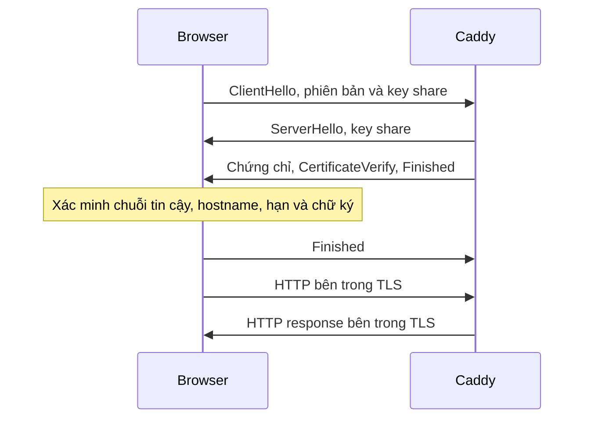
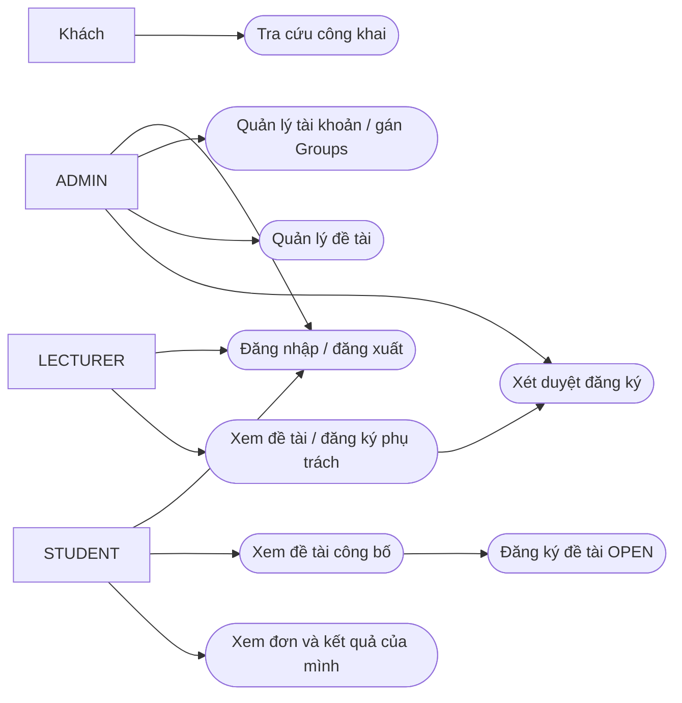
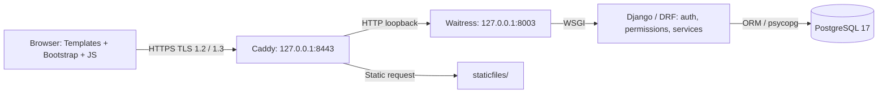
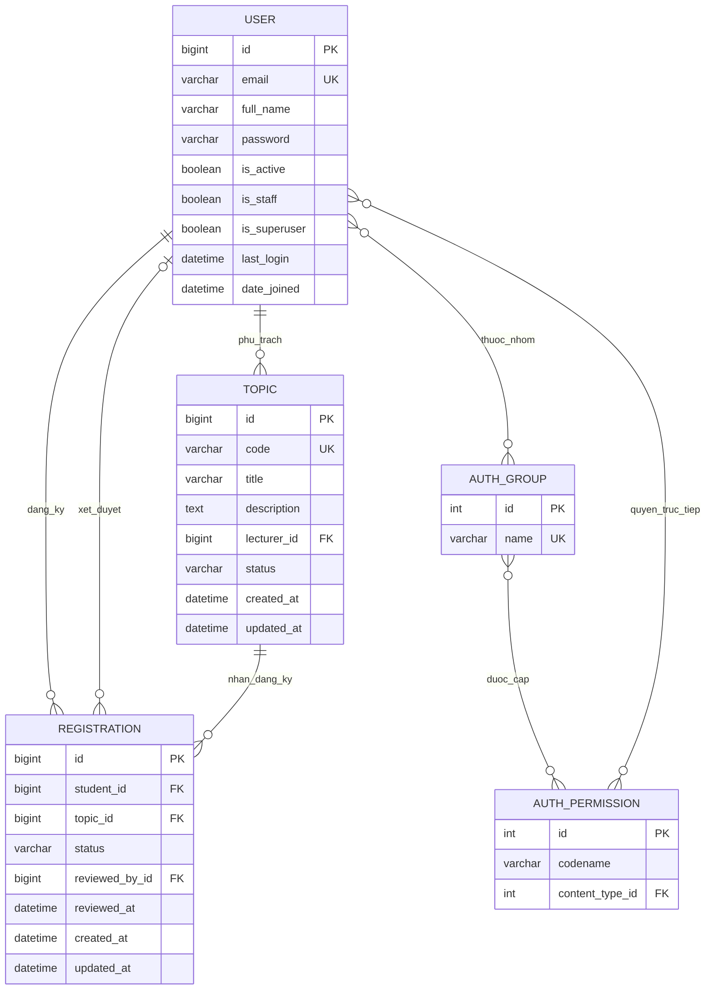
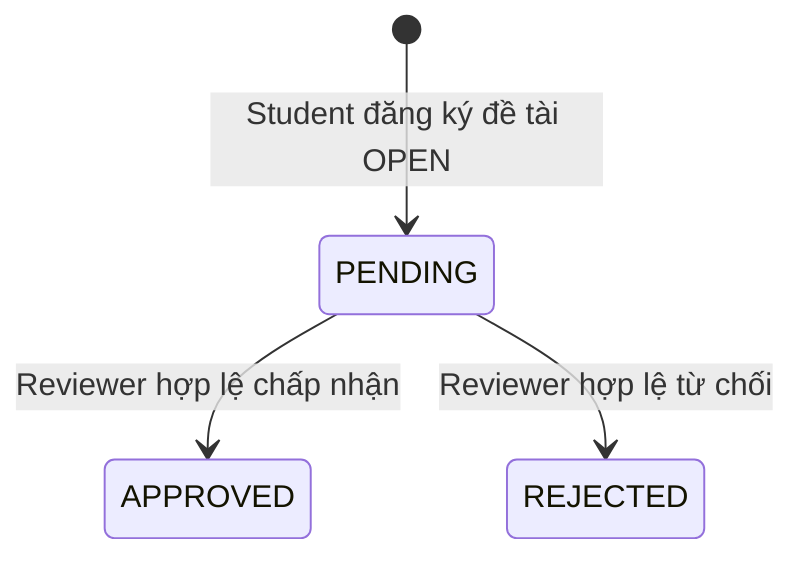

# KHCN-Security — Website quản lý đề tài KHCN sinh viên với TLS + JWT

README này là tài liệu cài đặt, vận hành và học mã nguồn cho nhóm phát triển. Nội dung lý thuyết được nối với các file triển khai thực tế để thành viên có thể giải thích và demo sản phẩm khi bảo vệ.

Hệ thống phục vụ ba vai trò **ADMIN, LECTURER, STUDENT**, sử dụng Django + PostgreSQL, JWT trong cookie HttpOnly và HTTPS local qua Caddy + Waitress.

> Phạm vi hiện tại: sản phẩm demo trên máy local. Các phần “đã triển khai” mô tả code đang có; phần hướng phát triển không phải chức năng đã hoàn thành. README không chứa mật khẩu, JWT hoặc private key.

<a id="muc-luc"></a>
## Mục lục

1. [Bắt đầu nhanh trên máy đã chuẩn bị](#bat-dau-nhanh)
2. [Công cụ, công nghệ và cấu trúc thư mục](#cong-nghe)
3. [Cài đặt trên máy mới](#cai-dat)
4. [Vận hành và xử lý sự cố](#van-hanh)
5. [Chương 1. Tổng quan và cơ sở lý thuyết](#chuong-1)
6. [Chương 2. Phân tích yêu cầu và thiết kế hệ thống](#chuong-2)
7. [Chương 3. Xây dựng, triển khai và kiểm thử hệ thống](#chuong-3)
8. [Kết luận và hướng phát triển](#ket-luan)
9. [Kịch bản demo và câu hỏi bảo vệ](#bao-ve)
10. [Tài liệu tham khảo chính thức](#tham-khao)

Sơ đồ dùng Mermaid; xem trực tiếp trên GitHub. Trong VS Code, khả năng hiển thị Mermaid phụ thuộc extension Markdown đang cài.

<a id="bat-dau-nhanh"></a>
## Bắt đầu nhanh trên máy đã chuẩn bị

Áp dụng khi PostgreSQL, `.venv`, `.env`, `.env.https`, chứng chỉ và Caddy đã sẵn sàng:

```powershell
Set-Location 'D:\BTL ANM\KHCN-Security'
.\.venv\Scripts\python.exe scripts/serve_https_demo.py
```

Giữ terminal mở và truy cập **https://localhost:8443/dang-nhap/**. Dừng đúng phiên bằng **Ctrl+C** tại terminal đó. Nếu website đang chạy, mở URL hiện có; không chạy thêm launcher.

| Vai trò | Email demo | Biến mật khẩu trong `.env` khi seed lần đầu |
| --- | --- | --- |
| ADMIN | `admin@khcn.example` | `DEMO_ADMIN_PASSWORD` |
| LECTURER | `lecturer@khcn.example` | `DEMO_LECTURER_PASSWORD` |
| STUDENT | `student@khcn.example` | `DEMO_STUDENT_PASSWORD` |

Không có mật khẩu mặc định trong source. Nếu mật khẩu trong DB đã được đổi, giá trị seed cũ trong `.env` không còn là mật khẩu đăng nhập.

<a id="cong-nghe"></a>
## Công cụ, công nghệ và cấu trúc thư mục

### Công cụ và dependency

Bảng dưới là phiên bản đã đối chiếu trên workspace lúc hoàn thiện README; đây không phải yêu cầu phải thay mọi công cụ hiện có bằng một bản mới.

| Công cụ/công nghệ | Phiên bản hoặc phạm vi | Vai trò |
| --- | --- | --- |
| Windows 11, PowerShell, VS Code | Môi trường phát triển | Chạy lệnh, sửa code, quản lý môi trường |
| Git, GitHub | Quản lý mã nguồn | Lưu phiên bản và phối hợp nhóm |
| Python | 3.13; máy kiểm chứng 3.13.14 | Ngôn ngữ backend |
| Django | 5.2.19 | ORM, models, templates, migrations, auth và quản trị |
| Django REST Framework | 3.18.3 | API, serializers, authentication, permissions, pagination |
| Simple JWT | 5.5.1 | Ký/xác minh JWT, refresh token, blacklist |
| PostgreSQL | 17; máy kiểm chứng 17.12 | Database quan hệ, constraints, transaction, row lock |
| psycopg với binary extra | 3.3.9 | Driver Python kết nối PostgreSQL |
| python-dotenv | 1.2.4 | Đọc cấu hình local từ biến môi trường/file env |
| Django Templates, HTML, CSS | Theo project | Render khung trang và danh mục công khai |
| Bootstrap | CSS 5.3.3 lưu local | Layout, grid và các thành phần responsive |
| JavaScript thuần, Fetch API | Không cần bước build frontend | Gọi API cùng origin và cập nhật UI |
| Manrope | Font local | Hiển thị tiếng Việt, không phụ thuộc font CDN |
| Caddy portable | 2.11.9, Windows amd64 | TLS termination, reverse proxy, static files |
| Waitress | 3.0.2 | WSGI server cho Django trên Windows |
| OpenSSL | Bản có sẵn trong PATH | Sinh CA/chứng chỉ và kiểm tra chuỗi chứng chỉ |
| Ruff | 0.17.6 | Lint và format Python |
| Chrome, Node.js | Công cụ QA tùy chọn | Tự động hóa kiểm tra giao diện; không cần để chạy website |

Dependency được pin trong [requirements.txt](requirements.txt). [requirements-deploy.txt](requirements-deploy.txt) bổ sung Waitress; [requirements-dev.txt](requirements-dev.txt) bổ sung Ruff. Hai file này đều tham chiếu requirements nền.

Bootstrap dùng giấy phép [MIT](static/vendor/bootstrap/LICENSE); Manrope dùng [OFL](static/fonts/OFL-Manrope.txt). Giữ các file giấy phép khi phân phối source.

### Cấu trúc thư mục

```text
KHCN-Security/
├── accounts/          # Custom User, JWT, quản lý tài khoản, Django Admin, tests
├── config/            # Settings HTTP/HTTPS, URL gốc, WSGI/ASGI
├── core/              # Trang chung, health, seed, security headers, test runner
├── topics/            # Đề tài: model, API, quyền, validation, services, tests
├── registrations/     # Đăng ký, xét duyệt, phạm vi dữ liệu và tests cạnh tranh
├── templates/         # Django Templates và các partial dùng chung
├── static/            # CSS/JS, Bootstrap, font và icon nguồn
├── deploy/Caddyfile   # Cấu hình HTTPS và reverse proxy
├── scripts/           # Setup/chạy HTTPS và các công cụ kiểm chứng
├── manage.py
├── requirements*.txt
├── pyproject.toml     # Cấu hình Ruff
├── .env.example       # Mẫu cấu hình, không chứa secret thật
├── .gitignore
└── README.md

Các mục chỉ có ở máy local, được Git bỏ qua:
├── .env               # Cấu hình HTTP, PostgreSQL, mật khẩu seed
├── .env.https         # Hai secret riêng của profile HTTPS
├── .venv/             # Môi trường Python
├── .runtime/          # CA, chứng chỉ, private key, log và evidence kỹ thuật
├── .tools/            # Caddy executable
├── staticfiles/       # Kết quả collectstatic đang được Caddy phục vụ
└── artifacts/         # Ảnh, kịch bản/profile QA và gói source được giữ local
```

`static/` là source; `staticfiles/` là bản đã thu thập để phục vụ HTTPS. Không xóa `static/` vì cho rằng đã có `staticfiles/`. Migrations và tests là thành phần của source, cần đưa vào Git.

<a id="cai-dat"></a>
## Cài đặt trên máy mới

### 1. Chuẩn bị môi trường và database

Cần Python 3.13, PostgreSQL 17 đang chạy và OpenSSL có trong PATH. Chuẩn bị source bằng Git hoặc giải nén, rồi mở **thư mục chứa `manage.py`**:

```powershell
Set-Location 'D:\BTL ANM\KHCN-Security'
py -3.13 --version
Get-Command openssl
```

Đường dẫn trên là ví dụ của máy phát triển; thành viên đổi thành đường dẫn checkout của mình. Nếu repository có thư mục cha, đi tiếp vào `KHCN-Security` trước khi chạy Django.

Trong pgAdmin hoặc SQL Shell của PostgreSQL, tạo database `khcn_security` nếu chưa tồn tại. Ví dụ với role local `postgres`:

```sql
CREATE DATABASE khcn_security OWNER postgres;
```

Chỉ thực hiện trên máy chưa có database; không drop/recreate database đang có dữ liệu. Nếu dùng role khác, thay owner và `POSTGRES_USER` tương ứng. Bản demo local có thể dùng role đã chuẩn bị; triển khai thật nên tách role ứng dụng theo nguyên tắc quyền tối thiểu.

### 2. Tạo môi trường ảo và cài packages

```powershell
if (-not (Test-Path -LiteralPath '.venv')) { py -3.13 -m venv .venv }
.\.venv\Scripts\python.exe -m pip install -r requirements-deploy.txt -r requirements-dev.txt
.\.venv\Scripts\python.exe -m pip check
```

Các lệnh dùng trực tiếp Python trong `.venv` nên không bắt buộc activate hoặc đổi ExecutionPolicy. Không xóa môi trường đang hoạt động chỉ để làm lại hướng dẫn.

### 3. Tạo và điền cấu hình

```powershell
if (-not (Test-Path -LiteralPath '.env')) {
    Copy-Item -LiteralPath '.env.example' -Destination '.env'
}
```

Mở `.env` bằng editor, điền các giá trị của riêng máy. Không copy secret của thành viên khác hoặc chụp file này vào minh chứng.

| Biến | Cách điền |
| --- | --- |
| `DJANGO_SECRET_KEY` | Chuỗi ngẫu nhiên mạnh; không dùng tên nhóm hoặc chuỗi dễ đoán |
| `DJANGO_DEBUG` | `True` cho profile development local; HTTPS profile sẽ tự đặt `False` |
| `DJANGO_ALLOWED_HOSTS` | Giữ localhost/127.0.0.1/[::1] cho development local |
| `JWT_SIGNING_KEY` | Khóa ngẫu nhiên độc lập, tối thiểu 32 ký tự; nên điền riêng cả khi phát triển |
| `POSTGRES_DB` | `khcn_security` hoặc tên database thực sự đã tạo |
| `POSTGRES_USER` | Role PostgreSQL dùng kết nối |
| `POSTGRES_PASSWORD` | Mật khẩu của role; tự nhập trong editor |
| `POSTGRES_HOST`, `POSTGRES_PORT` | Thường là `127.0.0.1`, `5432` |
| `POSTGRES_SSLMODE` | Mẫu đang là `prefer`; giá trị này không chứng minh kết nối DB có TLS |
| `DEMO_ADMIN_PASSWORD` | Mật khẩu riêng cho tài khoản Admin demo |
| `DEMO_LECTURER_PASSWORD` | Mật khẩu riêng cho Giảng viên demo |
| `DEMO_STUDENT_PASSWORD` | Mật khẩu riêng cho Sinh viên demo |

Ba mật khẩu demo phải khác nhau, dài tối thiểu 12 ký tự và đạt các validator Django về mức độ phổ biến, toàn số và tương tự thông tin người dùng. Có thể dùng trình quản lý mật khẩu để sinh và điền secret.

`config.settings` đọc `.env` trước; profile HTTPS sau đó dùng hai khóa riêng trong `.env.https`. Giữ `.env` phục vụ development local và không sửa hàng loạt nó khi chuyển sang HTTPS. Các biến đã được đặt trong process environment có thể ưu tiên hơn file; kiểm tra môi trường terminal nếu chạy sai database/profile.

Không dùng lệnh in secret ra terminal, không thêm `.env` vào Git, không đưa mật khẩu vào tham số dòng lệnh.

### 4. Migrate, seed và kiểm tra kết nối

```powershell
.\.venv\Scripts\python.exe manage.py check
.\.venv\Scripts\python.exe manage.py migrate
.\.venv\Scripts\python.exe manage.py seed_demo
```

Seed tạo ba Groups, cấp quyền nền, tạo ba tài khoản demo và **12 đề tài tiếng Việt**. Dữ liệu được nhận diện bằng email/mã đề tài; chạy lại không tạo bản ghi trùng, không reset mật khẩu hoặc ghi đè đề tài đã có. Seed vẫn kiểm tra cả ba mật khẩu môi trường trước khi ghi dữ liệu.

Nếu email demo đã tồn tại ngoài nhóm dự kiến, seed dừng để tránh tự nâng quyền. Seed không phải công cụ sửa tài khoản bị khóa. Các lệnh seed/sync có thể cấp lại model permissions tối thiểu, nên không chạy chúng giữa một bài demo thu hồi quyền.

Sau khi đã đổi mật khẩu trong DB, sửa `DEMO_*_PASSWORD` không đổi mật khẩu đó. Đặt lại có chủ ý bằng Django Admin hoặc lệnh nhập ẩn:

```powershell
.\.venv\Scripts\python.exe manage.py changepassword student@khcn.example
```

Lệnh hỏi mật khẩu tương tác; không truyền mật khẩu trực tiếp vào command.

### 5. Chạy HTTP development

```powershell
.\.venv\Scripts\python.exe manage.py runserver 127.0.0.1:8000
```

Mở http://127.0.0.1:8000/. Chỉ dùng HTTP loopback khi `DEBUG=True`. Đây là chế độ phát triển, không phải minh chứng cho yêu cầu TLS và không dùng runserver để phục vụ production.

### 6. Chuẩn bị và chạy HTTPS local

Thực hiện một lần trên checkout mới:

```powershell
.\.venv\Scripts\python.exe scripts/setup_https_demo.py
.\.venv\Scripts\python.exe manage.py collectstatic --noinput --settings=config.settings_https
.\.tools\caddy.exe validate --config deploy/Caddyfile --adapter caddyfile
.\.venv\Scripts\python.exe manage.py check --deploy --settings=config.settings_https
.\.venv\Scripts\python.exe scripts/serve_https_demo.py
```

Setup dùng OpenSSL hiện có để tạo CA, chứng chỉ localhost và hai secret độc lập, tải Caddy portable từ bản phát hành chính thức và kiểm tra SHA-256 của archive. Script không tự import CA vào Windows, không mở firewall hoặc cài service. File riêng tư được hạn chế ACL trên Windows.

Setup kiểm tra và dùng lại bộ chứng chỉ còn hợp lệ; không âm thầm ghi đè bộ key đang tồn tại một phần hoặc tự gia hạn chứng chỉ. Khi phát hiện thiếu/hết hạn, cần xử lý có chủ ý, không xóa cả `.runtime` để thử lại.

| Thành phần | Địa chỉ | Mục đích |
| --- | --- | --- |
| HTTPS frontend | `https://localhost:8443/` | URL demo chính |
| HTTPS thay thế | `https://127.0.0.1:8443/` | SAN cũng hỗ trợ địa chỉ này |
| HTTP redirect | `http://localhost:8080/` | Chuyển 308 sang HTTPS |
| Waitress nội bộ | `127.0.0.1:8003` | Upstream HTTP loopback, không dùng làm URL nghiệp vụ |
| HTTP development | `http://127.0.0.1:8000/` | Phiên runserver riêng, nếu được khởi động |

Link `localhost` chỉ trỏ tới chính máy đang mở trình duyệt. Thành viên ở máy khác không dùng được URL này để truy cập máy demo vì server chỉ bind loopback; mỗi máy cần tự cài và chạy bản local của mình.

### 7. Tin cậy CA demo: thao tác do người dùng quyết định

CA riêng không mặc nhiên được trình duyệt tin cậy. Lỗi `NET::ERR_CERT_AUTHORITY_INVALID` có thể xuất hiện dù server đã nói chuyện TLS được.

Chỉ khi quyết định tin CA do chính máy/nhóm quản lý, kiểm tra Subject/Thumbprint/thời hạn rồi tự import **chứng chỉ công khai**:

```powershell
$demoCa = [System.Security.Cryptography.X509Certificates.X509Certificate2]::new(
    (Resolve-Path '.runtime/tls/root-ca.crt').Path
)
$demoCa | Select-Object Subject, Thumbprint, NotAfter
Import-Certificate -FilePath '.runtime/tls/root-ca.crt' -CertStoreLocation 'Cert:\CurrentUser\Root'
```

Đây là thay đổi kho tin cậy của tài khoản Windows. Source/setup không tự thực hiện bước này. Không import `root-ca.key`, không gửi private key cho thành viên khác. Mỗi máy nên tự sinh bộ secret/CA local của mình.

Đóng hoàn toàn trình duyệt rồi mở lại. Không dùng `-k`, `verify=False`, `--ignore-certificate-errors` hoặc bấm bỏ qua cảnh báo để tuyên bố xác minh thành công.

Khi không còn cần tin CA demo, chỉ gỡ đúng thumbprint đã đối chiếu:

```powershell
$demoTrustPath = 'Cert:\CurrentUser\Root\' + $demoCa.Thumbprint
Get-Item -LiteralPath $demoTrustPath | Select-Object Subject, Thumbprint
# Chỉ chạy sau khi xác nhận đúng CA demo:
Remove-Item -LiteralPath $demoTrustPath
```

Không xóa các chứng chỉ khác. CA demo chưa có CRL/OCSP; công cụ dùng Schannel có thể báo không xác định được trạng thái thu hồi. Không tắt kiểm tra thu hồi để che lỗi.


<a id="van-hanh"></a>
## Vận hành và xử lý sự cố

### Các trang chính

| Trang | Đường dẫn | Người dùng |
| --- | --- | --- |
| Danh mục công khai | `/` | Khách và mọi vai trò; không có bản nháp |
| Đăng nhập JWT | `/dang-nhap/` | Tài khoản đang hoạt động |
| Dashboard | `/tong-quan/` | Dữ liệu lấy từ API theo quyền |
| Danh sách/chi tiết đề tài | `/de-tai/`, `/de-tai/<id>/` | Theo scope API |
| Đăng ký/xét duyệt | `/dang-ky/` | Nội dung thay đổi theo vai trò |
| Quản lý tài khoản | `/tai-khoan/` | ADMIN có permission phù hợp |
| Công cụ tài khoản/Groups | `/admin/accounts/user/` | Quản trị phụ trợ, đăng nhập riêng |
| Health | `/health/` | Kiểm tra Django và truy vấn DB |

Truy cập trang khung HTML có thể trả 200 ngay cả khi chưa đăng nhập. Các bản ghi nghiệp vụ riêng được tải từ API có JWT; không được suy ra quyền truy cập chỉ từ HTTP status của trang khung.

### Tạo tài khoản sinh viên/giảng viên

Hiện **không có tự đăng ký tài khoản công khai**. Admin cấp tài khoản:

1. Đăng nhập Admin ở giao diện nghiệp vụ.
2. Mở **Quản lý tài khoản → Phân quyền người dùng**. Nút chỉ hiện nếu server xác nhận có quyền và đủ điều kiện dùng Django Admin.
3. Đăng nhập công cụ quản trị riêng nếu được yêu cầu; cùng User/password nhưng khác cơ chế phiên.
4. Chọn thêm tài khoản, điền email, họ tên và mật khẩu đạt chính sách.
5. Lưu, sau đó gán đúng một nhóm nghiệp vụ: `STUDENT` hoặc `LECTURER`; giữ `is_active` khi muốn cho đăng nhập.
6. Cấp thông tin đăng nhập cho đúng người qua kênh phù hợp, không commit danh sách mật khẩu.

Không cấp `is_staff` hoặc `is_superuser` cho sinh viên/giảng viên. API tài khoản chính chỉ cho đọc và sửa email/họ tên/trạng thái; tạo tài khoản, đổi nhóm và đặt lại mật khẩu dùng công cụ quản trị hiện có.

Thành viên nhóm `ADMIN` không tự động có quyền truy cập Django Admin: công cụ này còn cần `is_staff` và model permissions. Admin demo được seed với điều kiện phù hợp; đó không phải superuser hệ thống. Admin thường không sửa cờ đặc quyền, không sửa tài khoản superuser, không tự bỏ nhóm/khóa chính mình. Nếu chuyển nhóm giảng viên, cần xem xét các đề tài đang được giao và bàn giao trách nhiệm trước.

### Các bước vận hành hằng ngày

1. Bật PostgreSQL; vào đúng thư mục và kiểm tra có `.env`/`.env.https`.
2. Chạy launcher HTTPS nếu chưa có phiên đang chạy.
3. Mở `/health/`; trạng thái bình thường là JSON `{"status":"ok","database":"ok"}`. Khi DB lỗi, endpoint trả 503 với thông báo tổng quát.
4. Đăng nhập theo vai trò và làm việc. Dùng các profile trình duyệt riêng nếu cần demo đồng thời ba người.
5. Sau khi đổi Python code, Ctrl+C ở terminal sở hữu launcher rồi chạy lại. Sau khi đổi JS/CSS/font, chạy collectstatic và Ctrl+F5.
6. Kết thúc phiên bằng nút đăng xuất; dừng launcher bằng Ctrl+C khi không dùng.

Cookie không tách biệt theo TCP port. Hai profile HTTP/HTTPS dùng tên cookie riêng để tránh xung đột. Khi kiểm thử, dùng nhất quán một hostname; không trộn cookie `localhost` và `127.0.0.1` trong cùng quy trình đăng nhập.

### Cập nhật source và bảo trì

Sau khi nhận phiên bản mới, đọc thay đổi, giữ cấu hình local và sao lưu dữ liệu trước khi áp dụng migration có thay đổi schema:

```powershell
.\.venv\Scripts\python.exe -m pip install -r requirements-deploy.txt -r requirements-dev.txt
.\.venv\Scripts\python.exe manage.py check
.\.venv\Scripts\python.exe manage.py migrate
.\.venv\Scripts\python.exe manage.py collectstatic --noinput --settings=config.settings_https
```

Không tự chạy seed mỗi lần khởi động. Nếu cần bổ sung lại quyền nền, có thể chạy `sync_topic_permissions` và `sync_registration_permissions` có chủ ý; chúng cộng thêm quyền, không thay thế việc xét quyền từng người. Không chạy trong lúc kiểm thử thu hồi permission.

Blacklist refresh lưu trong PostgreSQL. Lệnh bảo trì của Simple JWT là `python manage.py flushexpiredtokens` để dọn token đã hết hạn; dự án chưa cài lịch chạy tự động. Tham khảo [blacklist app của Simple JWT](https://django-rest-framework-simplejwt.readthedocs.io/en/stable/blacklist_app.html).

Nếu cần sao lưu, dùng pgAdmin Backup hoặc `pg_dump` của PostgreSQL 17. Ví dụ sau chỉ dùng khi thư mục đích ngoài repo đã tồn tại, thay user/database theo cấu hình:

```powershell
pg_dump --host=127.0.0.1 --port=5432 --username=postgres --dbname=khcn_security --format=custom --file='D:\KHCN-Backups\khcn_security.dump' --password
```

Mật khẩu được hỏi tương tác, không đặt trong command hoặc URI. Backup có dữ liệu người dùng, password hash và dữ liệu token; bảo vệ như dữ liệu nhạy cảm, không đưa lên GitHub. Thử khôi phục vào **database mới riêng**, không restore đè database demo đang sử dụng. Xem [hướng dẫn pg_dump 17](https://www.postgresql.org/docs/17/app-pgdump.html).

### Chẩn đoán sự cố thường gặp

| Hiện tượng | Kiểm tra và xử lý |
| --- | --- |
| Không tìm thấy `manage.py` | Đang ở sai thư mục; vào thư mục con `KHCN-Security` |
| ImportError hoặc thiếu package | Dùng đúng `.\.venv\Scripts\python.exe` và cài requirements |
| Không kết nối được PostgreSQL | Kiểm tra service, tên DB, host/port, role/password trong editor; không đổi sang SQLite |
| Seed báo lỗi mật khẩu | Điền đủ ba mật khẩu khác nhau và đạt validator; không in chúng để dò lỗi |
| Không đăng nhập bằng mật khẩu trong env | Env chỉ dùng lúc seed đầu; tài khoản có thể đã đổi mật khẩu/đã khóa |
| Login/API trả 403 | Kiểm tra HTTPS/localhost policy, CSRF token, Origin, Groups và model permissions |
| API trả 401 | Cookie thiếu/hết hạn/sai chữ ký, user bị khóa hoặc mật khẩu đã đổi; UI có thể thử refresh một lần |
| API trả 404 cho một object | ID không tồn tại hoặc ngoài scope; đây là policy tránh lộ object |
| Login trả 429 | Chờ cửa sổ throttle; không đổi IP/header để vượt kiểm soát |
| Không thấy nút phân quyền | Kiểm tra ADMIN, `is_staff` và `accounts.view_user`; không cấp staff cho Student để sửa UI |
| HTTPS báo cổng bận | Kiểm tra có phiên cũ; chỉ dừng terminal/process do mình sở hữu |
| Lỗi HTTPS chung, launcher thoát | Kiểm tra file setup/collectstatic, cấu hình, chứng chỉ và log local; không chia sẻ log thô |
| Browser báo CA không tin cậy | Đối chiếu đúng CA, SAN và thời hạn; chỉ tự import public CA khi đã quyết định tin cậy |
| Cert đã hết hạn/sắp hết hạn | Setup không tự gia hạn; xử lý bộ cert có chủ ý, không xóa cả runtime hoặc bypass |
| Trang thiếu style sau cập nhật | Chạy collectstatic đúng HTTPS profile và Ctrl+F5 |
| Django deploy check có W004 | HSTS=0 cố ý cho localhost; chưa bật preload/includeSubDomains |
| Test báo thiếu quyền tạo database | Cần role có CREATEDB hoặc test DB được quản trị chuẩn bị; không tự sửa quyền PostgreSQL |

Log launcher ở `.runtime/caddy.log` và `.runtime/waitress.log`. Chỉ xem nội bộ, lọc thông tin nhạy cảm trước khi chia sẻ; không bật chế độ in cookie/body/token để dò lỗi.

<a id="chuong-1"></a>
## CHƯƠNG 1. TỔNG QUAN VÀ CƠ SỞ LÝ THUYẾT

### 1.1. Tổng quan bài toán quản lý đề tài KHCN và yêu cầu bảo mật

Website tập trung hóa danh mục đề tài, người phụ trách, yêu cầu tham gia của sinh viên và kết quả xét duyệt. Quy trình thay thế việc gửi danh sách rời rạc bằng các bản ghi có trạng thái và người xử lý rõ ràng.

Ba lớp kiểm soát cần phối hợp:

| Câu hỏi | Cơ chế trong project | Ví dụ |
| --- | --- | --- |
| Người gửi yêu cầu là ai? | JWT authentication và tra User | Cookie hợp lệ gắn với user đang hoạt động |
| Người đó được làm gì, trên dữ liệu nào? | RBAC + object scope | Lecturer chỉ duyệt đơn của đề tài mình phụ trách |
| Yêu cầu/đáp ứng được bảo vệ khi truyền thế nào? | HTTPS/TLS | Browser xác minh chứng chỉ Caddy trước khi gửi dữ liệu |

Tài sản cần bảo vệ gồm mật khẩu/hash, token, thông tin tài khoản, đăng ký và quyết định xét duyệt. Rủi ro chính là giả mạo đăng nhập, vượt quyền, đoán ID, gửi yêu cầu thay người dùng, chèn dữ liệu độc hại và nghe lén/sửa dữ liệu trên đường truyền.

### 1.2. Cơ chế xác thực người dùng bằng JWT

#### 1.2.1. Khái niệm và cấu trúc JWT

JWT là định dạng truyền claims. Dạng signed compact dùng ở project có ba phần:

```text
base64url(header).base64url(payload).base64url(signature)
```

Header nêu thuật toán/loại token; payload chứa claims; signature giúp kiểm tra tính xác thực và toàn vẹn. Base64url chỉ là mã hóa biểu diễn, **không giữ bí mật payload**. Không đưa mật khẩu vào JWT. Cơ sở định dạng: [RFC 7519](https://www.rfc-editor.org/rfc/rfc7519).

Trong cấu hình hiện tại:

| Thành phần | Giá trị/ý nghĩa trong project |
| --- | --- |
| Thuật toán | `HS256`: HMAC-SHA256 dùng khóa bí mật đối xứng |
| `user_id` | ID tài khoản; server tra User, không lấy role từ client |
| `token_type` | Phân biệt access và refresh |
| `iat`, `exp` | Thời điểm phát hành và hết hạn |
| `jti` | Định danh token, dùng cho vòng đời refresh/blacklist |
| `iss`, `aud` | `khcn-security` và `khcn-security-web` |
| Thông tin revoke theo password | Simple JWT kiểm tra dấu vết password hash khi `CHECK_REVOKE_TOKEN=True` |

Khóa ký JWT trong HTTPS profile khác Django secret và khác private key TLS. Không dùng `alg` do client gửi để tự chọn một thuật toán khác với cấu hình server; nguyên tắc xác minh JWT được trình bày trong [RFC 8725](https://www.rfc-editor.org/rfc/rfc8725).

#### 1.2.2. Quy trình hoạt động và ưu/nhược điểm

Áp dụng trong hệ thống: user đăng nhập → server kiểm tra password → phát access/refresh bằng Set-Cookie → browser tự gửi access cookie → server xác minh token và User → kiểm tra quyền → thực thi nghiệp vụ. Chi tiết nằm ở [accounts/authentication.py](accounts/authentication.py), [accounts/api_views.py](accounts/api_views.py) và [accounts/services.py](accounts/services.py).

Access sống **5 phút**; refresh sống **1 ngày**. Refresh thành công cấp cặp mới và blacklist refresh cũ. Logout xóa cookie và blacklist refresh hiện có. Access đã phát hành không bị blacklist ngay khi logout, có thể còn dùng tới hết hạn nếu user/password chưa bị vô hiệu hóa.

Ưu điểm của lựa chọn hiện tại là dùng chung lớp xác thực cho API và kiểm tra chữ ký/thời hạn rõ ràng. Đổi lại cần quản lý secret, cookie/CSRF, replay refresh và thời điểm thu hồi. HttpOnly giảm khả năng JavaScript đọc token; không bảo đảm miễn nhiễm XSS.

Đây không phải hệ thống hoàn toàn “stateless”: API vẫn tra User/Groups/permissions, refresh có bảng outstanding/blacklist trong DB. Thay Groups có hiệu lực ở yêu cầu tiếp theo mà không cần nhét role mới vào JWT. Cấu hình thư viện tham khảo tại [Simple JWT settings](https://django-rest-framework-simplejwt.readthedocs.io/en/stable/settings.html).

### 1.3. Cơ chế phân quyền RBAC

RBAC gắn quyền với vai trò, rồi gán người dùng vào vai trò, thay vì viết điều kiện theo từng email. Khái niệm nền: [NIST RBAC](https://csrc.nist.gov/projects/role-based-access-control).

Project dùng `Django Groups` làm vai trò và `Permission` làm quyền thao tác. Có nhóm ADMIN chưa đủ nếu thiếu model permission cần thiết; có model permission ghi nhưng đang là STUDENT cũng không vượt được điều kiện vai trò.

Ngoài quyền thao tác, server giới hạn **tập bản ghi**. Lecturer có quyền xét duyệt nhưng chỉ trong đề tài phụ trách; Student chỉ xem đăng ký của mình. Đây là phần object-level authorization bổ sung cho RBAC. Phần triển khai ở [topics/permissions.py](topics/permissions.py), [registrations/permissions.py](registrations/permissions.py) và các service.

`is_staff` cho phép vào cổng Django Admin khi đủ điều kiện; `is_superuser` là quyền hệ thống native. Hai cờ này không tự chọn vai trò nghiệp vụ cho API. Giải thích Groups/permissions của nền tảng: [Django authentication](https://docs.djangoproject.com/en/5.2/topics/auth/default/).

### 1.4. Giao thức bảo mật TLS và HTTPS

#### 1.4.1. Tổng quan và nguyên lý bảo mật TLS

HTTPS là HTTP được bảo vệ bởi TLS. Với chứng chỉ được xác minh đúng, TLS hỗ trợ xác thực server, giữ bí mật và phát hiện sửa đổi dữ liệu truyền. Nó không thay thế validation, CSRF hay phân quyền ở ứng dụng.

Project cho phép TLS 1.2/1.3. Chứng chỉ RSA 3072-bit xác thực server; dữ liệu ứng dụng dùng khóa đối xứng được thiết lập trong handshake. Không nên trình bày rằng RSA mã hóa toàn bộ HTTP. Tham khảo [RFC 8446 — TLS 1.3](https://www.rfc-editor.org/rfc/rfc8446).

#### 1.4.2. Thiết lập kết nối và vai trò bảo vệ dữ liệu

Sơ đồ khái quát một kết nối mới TLS 1.3; TLS 1.2 có trình tự chi tiết khác:



Trong hệ thống này TLS kết thúc ở Caddy. Caddy → Waitress là HTTP loopback, còn kết nối PostgreSQL đã kiểm chứng hiện **không có TLS**. Vì vậy chỉ tuyên bố mã hóa đoạn browser ↔ Caddy; không gọi toàn bộ đường đi là mã hóa đầu cuối.

### 1.5. Các công nghệ xây dựng hệ thống

Django cung cấp model/ORM, migrations, templates và tài khoản; DRF tổ chức API; Simple JWT xử lý token; PostgreSQL giữ dữ liệu và tính nhất quán. Bootstrap/JavaScript làm giao diện gọi API. Caddy đảm nhận TLS/static và Waitress chuyển request thành WSGI cho Django.

Lựa chọn này phù hợp quy mô một ứng dụng Django, nhóm nhỏ và thời gian phát triển ngắn: không cần thêm SPA framework, server frontend riêng hoặc kho role thứ hai. Phiên bản và vai trò từng công cụ nằm ở [bảng công nghệ](#cong-nghe).


<a id="chuong-2"></a>
## CHƯƠNG 2. PHÂN TÍCH YÊU CẦU VÀ THIẾT KẾ HỆ THỐNG

### 2.1. Xác định yêu cầu hệ thống và các tác nhân

#### 2.1.1. Yêu cầu chức năng và phi chức năng

| Nhóm | Yêu cầu đã thực hiện |
| --- | --- |
| Tài khoản | Đăng nhập email/password; khóa/mở tài khoản; cấp tài khoản và gán Groups bằng công cụ quản trị |
| Đề tài | Danh sách, chi tiết, tìm mã/tên, lọc trạng thái, phân trang; Admin tạo/sửa/xóa có điều kiện |
| Đăng ký | Student đăng ký đề tài OPEN; mỗi cặp student-topic chỉ một bản ghi |
| Xét duyệt | Admin hoặc Lecturer đúng phạm vi chấp nhận/từ chối đơn PENDING; lưu người và thời điểm |
| Xác thực | Access/refresh JWT trong cookie HttpOnly; kiểm tra token và tài khoản đang hoạt động |
| Phân quyền | Backend kiểm tra role, model permissions và scope bản ghi |
| Truyền tải | HTTPS local với chứng chỉ được xác minh; upstream chỉ loopback |
| Chất lượng | ORM, serializer validation, constraints, transaction, tests và Ruff |
| Giao diện | Tiếng Việt, responsive, loading/empty/error states và xác nhận thao tác quan trọng |

Phi chức năng gồm không hardcode secret, không trả dữ liệu ngoài scope, không lộ token trong JSON/web storage, giữ mật khẩu dạng hash và có cách tái lập cài đặt. Không có cam kết SLA/khả năng chịu tải production vì chưa có benchmark hoặc triển khai Internet.

#### 2.1.2. Các tác nhân

| Tác nhân | Nhiệm vụ |
| --- | --- |
| Khách | Xem/tìm danh mục công khai không có DRAFT; không dùng API nghiệp vụ riêng |
| ADMIN | Quản lý tài khoản, phân công Lecturer, CRUD đề tài, xem và xét duyệt mọi đăng ký |
| LECTURER | Xem đề tài do mình phụ trách, xem và xét duyệt các đăng ký thuộc các đề tài đó |
| STUDENT | Xem đề tài đã công bố, đăng ký đề tài OPEN và theo dõi đơn của mình |

Superuser là khái niệm quản trị hệ thống Django, không phải tác nhân nghiệp vụ thứ tư. Chỉ tạo thêm superuser khi thực sự cần quản trị hệ thống, không dùng thay bộ ba tài khoản demo.

### 2.2. Phân tích các trường hợp sử dụng

#### 2.2.1. Sơ đồ Use Case tổng quát

Đây là sơ đồ chức năng biểu diễn bằng Mermaid flowchart, không phải ký pháp UML Use Case đầy đủ:



Mỗi mũi tên chỉ khả năng dùng chức năng; điều kiện quyền và phạm vi phải đọc cùng ma trận RBAC ở mục 2.4.2.

#### 2.2.2. Các Use Case chính

| Use Case | Tiền điều kiện | Luồng chính | Kết quả/ngoại lệ |
| --- | --- | --- | --- |
| Đăng nhập | User tồn tại, đang hoạt động; CSRF hợp lệ | Nhập email/password → xác thực → cấp cookies | Thành công 200; sai thông tin 401; CSRF sai 403; quá tần suất 429 |
| Quản lý tài khoản | ADMIN + permission | Tìm/lọc → sửa email/họ tên/trạng thái → xác nhận khi cần | Không tự khóa, không sửa đặc quyền qua API; email trùng bị từ chối |
| Cấp tài khoản/gán nhóm | Đủ quyền native Admin | Thêm user → gán STUDENT/LECTURER → bàn giao đăng nhập | Không có public signup; không cấp staff/superuser cho SV/GV |
| Quản lý đề tài | ADMIN + permission | Chọn Lecturer hợp lệ → tạo/sửa → lưu | Mã không trùng; xóa đề tài có đăng ký trả 409 |
| Đăng ký đề tài | STUDENT + permission, đề tài OPEN | Gửi topic ID → server lấy student từ JWT → tạo PENDING | Ngoài scope 404; trùng/không OPEN trả 409 |
| Xét duyệt | ADMIN hoặc Lecturer đúng phạm vi + permission | Mở đơn → chấp nhận/từ chối → ghi audit | Chỉ một quyết định thắng; xử lý lại trả 409 |
| Đăng xuất | CSRF hợp lệ | Blacklist refresh nếu hợp lệ → xóa cookies | 204; access cũ có thể còn hiệu lực tới exp |

### 2.3. Thiết kế kiến trúc và cơ sở dữ liệu

#### 2.3.1. Kiến trúc tổng thể



Django render danh mục công khai trực tiếp bằng ORM/templates. Các trang làm việc render khung, sau đó JavaScript gọi API cùng origin. Không có React/SPA server, CORS API cho website khác hoặc kho role riêng.

Phân chia backend:

| Thành phần | Trách nhiệm | File tiêu biểu |
| --- | --- | --- |
| Model | Dữ liệu, FK, constraints | [topics/models.py](topics/models.py) |
| Serializer/parser | Kiểm tra input, định dạng output, giới hạn JSON | [topics/serializers.py](topics/serializers.py), [topics/parsers.py](topics/parsers.py) |
| Authentication | Đọc cookie và xác minh JWT/User/CSRF | [accounts/authentication.py](accounts/authentication.py) |
| Permission/queryset | Quyền thao tác, phạm vi object | [registrations/permissions.py](registrations/permissions.py) |
| Service | Transaction, lock, chuyển trạng thái | [registrations/services.py](registrations/services.py) |
| View/ViewSet | Điều phối request và response | [topics/api_views.py](topics/api_views.py) |
| Middleware HTTPS | Thêm security headers, không quyết định role | [core/middleware.py](core/middleware.py) |

Proxy được giới hạn rõ: Caddy đặt lại `X-Forwarded-Proto`, loại header forwarding không được tin; Waitress chỉ tin proxy loopback và header proto được cấu hình, đổi thành WSGI scheme. Django không đọc trực tiếp raw forwarding header để quyết định HTTPS. Xem [deploy/Caddyfile](deploy/Caddyfile) và [scripts/serve_wsgi.py](scripts/serve_wsgi.py).

#### 2.3.2. ERD và thiết kế bảng dữ liệu



Sơ đồ rút gọn các quan hệ M:N. Django thực sự tạo các bảng nối `accounts_user_groups`, `auth_group_permissions` và `accounts_user_user_permissions`. Ba bảng nghiệp vụ là `accounts_user`, `topics_topic` và `registrations_registration`. Ngoài ra có bảng auth/contenttypes/admin/session và `token_blacklist_*` do các app Django/Simple JWT quản lý.

**User:** kế thừa AbstractUser, bỏ username/first_name/last_name và dùng email làm `USERNAME_FIELD`. Email được chuẩn hóa lowercase/trim và có unique constraint theo `Lower(email)`. `full_name` tối đa 150 ký tự. Password lưu hash theo Django, không lưu plaintext và không có cột role riêng.

**Topic:** code tối đa 30, duy nhất, chỉ chữ in hoa/số/dấu gạch nối; title tối đa 255. Lecturer phải thuộc nhóm LECTURER; API còn yêu cầu đang hoạt động. Description giới hạn 10.000 ký tự ở serializer. Trạng thái:

| Giá trị | Ý nghĩa | Student được đăng ký mới? |
| --- | --- | --- |
| `DRAFT` | Bản nháp | Không; API Student không thấy |
| `OPEN` | Đang mở đăng ký | Có |
| `CLOSED` | Đã đóng | Không |
| `COMPLETED` | Hoàn thành | Không |

**Registration:** unique constraint trên `(student, topic)` chặn trùng kể cả cạnh tranh. FK dùng `PROTECT` để không xóa đối tượng đang được tham chiếu. `reviewed_by`/`reviewed_at` nullable để hỗ trợ trạng thái chưa xử lý và dữ liệu lịch sử; service xét duyệt mới luôn ghi cả hai. DB constraint yêu cầu hai trường audit cùng null, hoặc cùng có giá trị với trạng thái APPROVED/REJECTED.

`WITHDRAWN` có trong model nhưng hiện **chưa có API/nút rút đơn**. Không trình bày đây là chức năng đã hoàn thành. Luồng hiện có:



Các index theo trạng thái/mã và topic/status hỗ trợ truy vấn. Timestamp dùng `USE_TZ=True`; timezone hiển thị cấu hình là `Asia/Ho_Chi_Minh`. ORM/services giữ logic nghiệp vụ; DB constraints là lớp bảo vệ bổ sung, không thay permission.

### 2.4. Thiết kế các cơ chế bảo mật

#### 2.4.1. Luồng đăng nhập, cấp và xác minh JWT

```mermaid
sequenceDiagram
    actor U as Người dùng
    participant B as Browser / JS
    participant A as Django Auth API
    participant DB as PostgreSQL
    B->>A: GET /api/auth/csrf/
    A-->>B: CSRF cookie HttpOnly + masked csrfToken trong JSON
    U->>B: Nhập email / password
    B->>A: POST login + cookie + X-CSRFToken
    A->>A: Kiểm tra transport, CSRF, throttle
    A->>DB: Xác thực user / password / is_active
    DB-->>A: User hợp lệ
    A->>DB: Ghi outstanding refresh
    A-->>B: Set-Cookie access/refresh; JSON user + CSRF mới
    B->>A: Request API, browser tự gửi access cookie
    A->>A: Kiểm tra chữ ký, claims, hạn, loại token
    A->>DB: Kiểm tra User, Groups, permissions, scope
    A-->>B: Dữ liệu được phép hoặc lỗi phù hợp
```

Login/refresh/logout có kiểm tra CSRF riêng qua `RequireCSRF`, dù không yêu cầu access token còn hạn. API nghiệp vụ dùng `CookieJWTAuthentication` và gọi `enforce_csrf` khi cần. Không giả định CsrfViewMiddleware mặc định đã bảo vệ mọi DRF endpoint.

GET/HEAD/OPTIONS không yêu cầu CSRF theo policy. POST/PUT/PATCH/DELETE dùng cookie cần token CSRF hợp lệ, kiểm tra Origin/Referer theo cơ chế Django. JS lấy masked token từ endpoint cùng origin, gửi `X-CSRFToken`; không phải đọc JWT. Xem [accounts/security.py](accounts/security.py) và [Django CSRF](https://docs.djangoproject.com/en/5.2/ref/csrf/).

| Cookie HTTPS | Path | Thuộc tính |
| --- | --- | --- |
| `__Secure-khcn_access` | `/api/` | Secure, HttpOnly, SameSite=Lax |
| `__Secure-khcn_refresh` | `/api/auth/` | Secure, HttpOnly, SameSite=Lax |
| `__Host-khcn_csrftoken` | `/` | Secure, HttpOnly, SameSite=Lax, không Domain |
| `__Host-khcn_sessionid` | `/` | Session riêng của Django Admin, Secure/HttpOnly |

Không lưu JWT vào localStorage/sessionStorage hoặc JSON response. HttpOnly không cấm người sở hữu máy xem cookie bằng DevTools; không chụp/copy giá trị token làm minh chứng công khai. SameSite là một lớp hỗ trợ, không thay CSRF check.

#### 2.4.2. Ma trận phân quyền RBAC thực tế

Bảng giả định user đang hoạt động và có model permissions nền. “Phạm vi” được server áp vào queryset trước khi trả list/detail.

| Thao tác qua API nghiệp vụ | ADMIN | LECTURER | STUDENT |
| --- | --- | --- | --- |
| Xem/tìm/lọc đề tài | Tất cả, gồm DRAFT | Chỉ đề tài mình phụ trách | Các đề tài không DRAFT |
| Tạo/sửa/xóa đề tài | Có, cần permission tương ứng | Không, kể cả đề tài mình phụ trách | Không |
| Xem danh sách Lecturer để phân công | Có quyền add/change topic | Không | Không |
| Đăng ký đề tài | Không đăng ký thay Student | Không | Có, OPEN và chưa đăng ký |
| Xem đơn đăng ký | Tất cả | Thuộc đề tài mình phụ trách | Của chính mình |
| Chấp nhận/từ chối | Có, đơn PENDING | Có, đúng phạm vi và PENDING | Không |
| Xem/sửa tài khoản | Có, theo permission và giới hạn tài khoản hệ thống | Không | Không |
| Gán Groups/tạo tài khoản | Dùng công cụ Admin riêng nếu đủ điều kiện | Không | Không |
| Tự nâng role bằng request | Không có API tự nâng role | Không | Không |

Danh mục `/` là thông tin **công khai** về mọi đề tài đã công bố, không bị lọc theo Lecturer đăng nhập. Đây là policy công khai riêng; không có đăng ký, email Student hoặc bản nháp ở danh mục đó.

Nhóm/quyền lấy từ server, không tin body/header/claim role tự gửi. Khi user có nhiều nhóm, thứ tự chọn vai trò là **ADMIN → LECTURER → STUDENT**; không cộng scope Student để mở rộng scope Lecturer. Nên gán một vai trò nghiệp vụ để trách nhiệm rõ ràng.

Các API yêu cầu JWT hợp lệ; session Django Admin hoặc chỉ một header `Authorization: Bearer ...` không thay thế cookie JWT trong thiết kế hiện tại. Khái niệm authentication và permissions của DRF được mô tả tại [DRF Authentication](https://www.django-rest-framework.org/api-guide/authentication/).

Policy lỗi: thiếu/sai JWT thường 401; đã xác thực nhưng thiếu quyền hoặc CSRF sai trả 403; object thiếu/ngoài scope trả 404 nhất quán. Không dùng HTTP 200 để che lỗi.

#### 2.4.3. Thiết lập kết nối HTTPS

Root CA tự ký tên `KHCN Local Demo Root CA` có hạn 365 ngày; leaf localhost do CA đó ký có hạn 30 ngày, SAN `localhost` và `127.0.0.1`. `server-chain.pem` chứa leaf và CA; private key giữ local. Key không có passphrase để server đọc khi khởi động, nên ACL và quyền truy cập máy là quan trọng.

Caddy chỉ cho TLS 1.2/1.3, không tự xin public certificate vì `auto_https off`. HTTP 8080 chuyển sang URL HTTPS chuẩn. Waitress bind 127.0.0.1:8003, không 0.0.0.0. Cấu hình hiện tại dùng HSTS=0 cho demo local và không bật preload/includeSubDomains.

Ba kiểm tra phải tách biệt: server bắt tay TLS được; client xác minh đúng CA/hostname/thời hạn; browser/OS có tin CA đó hay chưa. CA riêng được xác minh bằng file CA không đồng nghĩa mọi máy trên Internet tự tin nó. Hướng dẫn cấu hình nền tảng: [Caddy TLS](https://caddyserver.com/docs/caddyfile/directives/tls), [Waitress arguments](https://docs.pylonsproject.org/projects/waitress/en/stable/arguments.html).


<a id="chuong-3"></a>
## CHƯƠNG 3. XÂY DỰNG, TRIỂN KHAI VÀ KIỂM THỬ HỆ THỐNG

### 3.1. Xây dựng và triển khai các chức năng Website

#### 3.1.1. Xác thực và quản lý tài khoản

| Method | Endpoint | Điều kiện và tác dụng |
| --- | --- | --- |
| GET | `/api/auth/csrf/` | Lấy masked CSRF token; không yêu cầu đăng nhập |
| POST | `/api/auth/login/` | Email/password + CSRF; cấp cookies, không trả JWT trong JSON |
| POST | `/api/auth/refresh/` | Refresh cookie + CSRF; rotation và blacklist token cũ |
| POST | `/api/auth/logout/` | CSRF; thu hồi refresh nếu có, xóa cookies, trả 204 |
| GET | `/api/auth/me/` | Access JWT; trả ID/email/họ tên/roles từ server |
| GET | `/api/accounts/` | ADMIN + view_user; danh sách có phân trang |
| GET | `/api/accounts/<id>/` | ADMIN + view_user; chi tiết tài khoản |
| PATCH | `/api/accounts/<id>/` | ADMIN + view/change_user + CSRF; sửa email/full_name/is_active |
| GET | `/api/accounts/capabilities/` | ADMIN + view_user; quyền chỉnh sửa thực tế |

API tài khoản không có POST tạo hoặc DELETE tài khoản, không nhận role/groups/password/staff/superuser để sửa. Các trường ngoài danh sách được phép bị từ chối. Tìm tài khoản bằng `search`, lọc `role`, `active=true|false`, `page` và `page_size`.

Vai trò trong JSON `me` phục vụ hiển thị UI; mọi request vẫn lấy quyền phía server. Cửa sổ Django Admin dùng session auth riêng để cấp tài khoản/gán Groups. Đăng xuất JWT không tự kết thúc session native Admin; nếu đã dùng cả hai, thoát cả hai hoặc đóng profile riêng sau demo.

#### 3.1.2. Quản lý, đăng ký và xét duyệt đề tài

| Method | Endpoint | Chức năng/quyền |
| --- | --- | --- |
| GET | `/api/topics/` | List/search/filter/pagination theo scope và view_topic |
| GET | `/api/topics/<id>/` | Chi tiết trong scope |
| POST | `/api/topics/` | ADMIN + add_topic + CSRF |
| PUT/PATCH | `/api/topics/<id>/` | ADMIN + change_topic + CSRF |
| DELETE | `/api/topics/<id>/` | ADMIN + delete_topic + CSRF; 409 nếu có liên quan |
| GET | `/api/topics/capabilities/` | Quyền và trạng thái phục vụ UI |
| GET | `/api/topics/lecturers/` | ADMIN có add/change_topic; chọn Lecturer đang hoạt động |
| GET | `/api/registrations/` | Đơn đăng ký trong scope |
| GET | `/api/registrations/<id>/` | Chi tiết đơn trong scope |
| POST | `/api/registrations/` | STUDENT + quyền đăng ký + CSRF; body chỉ `topic` |
| POST | `/api/registrations/<id>/approve/` | ADMIN/Lecturer đúng scope + change_registration + CSRF |
| POST | `/api/registrations/<id>/reject/` | Điều kiện như approve |
| GET | `/api/registrations/capabilities/` | Khả năng đăng ký/xét duyệt phía server |

Quyết định xét duyệt không nhận `student`, `status`, `reviewed_by` hoặc `reviewed_at` do client chỉ định. Endpoint approve/reject nhận body JSON rỗng; danh tính reviewer lấy từ JWT, thời gian lấy từ server.

Ví dụ query, thay ID bằng dữ liệu thực tế:

```text
/api/topics/?search=KHCN-001&status=OPEN&page=1&page_size=12
/api/registrations/?status=PENDING&topic=1&page=1&page_size=12
/api/accounts/?search=nguyen&role=LECTURER&active=true
```

Mặc định 12 bản ghi/trang, tối đa 100; API từ chối page/page_size không hợp lệ. Response phân trang có `count`, `next`, `previous`, `results`; count được tính **sau khi lọc scope**, không tiết lộ tổng bản ghi riêng của người khác.

Đăng ký và xét duyệt dùng `transaction.atomic` + `select_for_update`. Service khóa Topic trước, rồi kiểm tra/khóa Registration theo thứ tự thống nhất. Khi có hai yêu cầu cạnh tranh, unique constraint/lock và kiểm tra trạng thái giúp chỉ một đăng ký hoặc quyết định hợp lệ được ghi. Khi xét duyệt phải đọc lại scope sau khi chờ lock để phản ánh việc đổi Lecturer.

### 3.2. Triển khai các cơ chế bảo mật

#### 3.2.1. Cấp phát và xác minh JWT

`CookieJWTAuthentication` kế thừa Simple JWT, đọc access cookie rồi dùng các hàm xác minh token và tra User. Nó kiểm tra transport trước khi xác thực. API nghiệp vụ không dùng SessionAuthentication và không dùng localStorage để giữ phiên.

`rotate_refresh` khóa bản ghi OutstandingToken trong transaction, kiểm tra lại blacklist sau khi chờ lock, xác minh user rồi thu hồi token cũ/cấp mới. Cơ chế này xử lý cả cạnh tranh refresh/logout, không chỉ bật một cờ cấu hình. JS gom các request refresh đồng thời qua một Promise và chỉ thử lại request sau 401 một lần.

Không tuyên bố “logout vô hiệu ngay mọi JWT”: refresh được thu hồi, access cũ còn thời gian sống tối đa 5 phút. Khóa tài khoản hoặc đổi mật khẩu làm token không còn đáp ứng policy User/password của server.

#### 3.2.2. Kiểm soát truy cập: DRF permissions, queryset và service

Trong project **không có RBAC middleware riêng**. Thành phần bảo vệ theo request là DRF authentication/permission; object scope và transaction được kiểm tra tiếp ở queryset/service. Tên “RBAC middleware” trong đề cương nên được giải thích theo cách triển khai thực tế này.

Ví dụ: Lecturer gửi `POST /api/registrations/123/approve/`:

1. Xác minh access JWT, user active và CSRF.
2. Kiểm tra nhóm Lecturer/Admin và permission xét duyệt.
3. Tìm ID 123 trong queryset được phép; nếu ngoài scope, trả 404.
4. Trong transaction, khóa và kiểm tra lại phạm vi/trạng thái.
5. Chỉ ghi APPROVED cùng reviewer/time do server xác định.

Django Admin phụ trợ cũng có guard cho User/Topic: staff Student/Lecturer bị cấp nhầm model permissions vẫn không được quản trị các dữ liệu này. Superuser hệ thống giữ khả năng quản trị native; điều đó không tự biến tài khoản thành ADMIN của API.

#### 3.2.3. Chứng chỉ TLS, headers và bảo vệ bổ sung

| Biện pháp | Triển khai | Giới hạn cần hiểu |
| --- | --- | --- |
| HTTPS | Caddy + CA local, TLS 1.2/1.3 | Chỉ browser–Caddy được mã hóa trong cấu hình hiện tại |
| Cookie | Secure/HttpOnly/SameSite=Lax ở HTTPS | HttpOnly không ngăn XSS gửi request thay user |
| CSRF | Check rõ ràng trong auth/permission DRF | Không thay bằng chỉ ẩn nút hoặc SameSite |
| SQL Injection | ORM parameterization, không ghép input vào SQL nghiệp vụ | Cần giữ nguyên nguyên tắc khi mở rộng code |
| XSS | Template autoescape, JS textContent, description dạng text | Không biến thành rich HTML nếu chưa có sanitizer/policy |
| IDOR | Scoped queryset + object permission + service | Đoán ID không được bỏ qua scope |
| Mass assignment | Serializer chỉ nhận field cho phép | Không lấy role/identity/audit từ request |
| JSON body | Parser nghiệp vụ tối đa 64 KiB | Lớp ngoài Caddy/Waitress giới hạn khoảng 128 KB |
| Login throttle | `10/min` | Theo IP cache process, không phải DDoS protection |
| Refresh throttle | `30/min` | Không phải rate limit phân tán nhiều worker |
| Security headers | CSP, nosniff, DENY framing, Referrer/Permissions Policy | HSTS chưa bật cho demo local |
| Logging | Không chủ ý log password/cookie/JWT; lọc log test đúng phạm vi | Vẫn cần kiểm tra log khi bổ sung chức năng |

CSP của HTTPS chỉ cho script/style/font cùng origin; tài nguyên frontend được phục vụ local. Khi bổ sung UI, ưu tiên JS/CSS file riêng, không nới CSP để chạy inline tùy tiện. `NUM_PROXIES=0` khiến client-supplied X-Forwarded-For không chọn bucket throttle; qua proxy local các user hiện dùng chung bucket IP.

### 3.3. Kiểm thử hệ thống

#### 3.3.1. Kiểm thử chức năng nghiệp vụ

Từ thư mục có manage.py, chạy:

```powershell
.\.venv\Scripts\python.exe manage.py check
.\.venv\Scripts\python.exe manage.py makemigrations --check --dry-run
.\.venv\Scripts\python.exe manage.py migrate --check
.\.venv\Scripts\python.exe manage.py test --noinput
.\.venv\Scripts\python.exe -m pip check
.\.venv\Scripts\python.exe -m ruff check --no-cache .
.\.venv\Scripts\python.exe -m ruff format --check --no-cache .
.\.venv\Scripts\python.exe manage.py check --deploy --settings=config.settings_https
```

Tests dùng PostgreSQL test DB riêng, thường là `test_khcn_security`, không dùng SQLite. Role chạy test cần tạo database test hoặc được quản trị chuẩn bị trước; khi thiếu quyền, báo lỗi để xử lý, không tự cấp quyền. `--noinput` chỉ nên dùng khi biết rõ database test dành riêng cho lần kiểm thử và không phải DB của người khác. Không chạy hai bộ test dùng chung tên DB cùng lúc.

| Nhóm test | Nội dung | File tiêu biểu |
| --- | --- | --- |
| Model/seed | Constraints, email, vai trò, seed idempotent | [accounts/tests.py](accounts/tests.py), [core/tests.py](core/tests.py) |
| JWT/CSRF | Login, expiry, chữ ký, inactive, refresh/logout, cookie | [accounts/test_auth.py](accounts/test_auth.py) |
| Quản lý tài khoản | Chỉ field được phép, role, tự khóa, email trùng | [accounts/test_management.py](accounts/test_management.py) |
| Topic API | CRUD, scope, RBAC, validation, search/filter/page | [topics/test_api.py](topics/test_api.py) |
| Registration API | Đăng ký, IDOR, review/audit, trạng thái | [registrations/test_api.py](registrations/test_api.py) |
| Cạnh tranh | Đăng ký trùng, approve/reject đồng thời | [registrations/test_concurrency.py](registrations/test_concurrency.py) |
| Admin phụ trợ | Chặn staff không ADMIN, chống tự nâng quyền | [accounts/test_admin.py](accounts/test_admin.py), [topics/test_admin.py](topics/test_admin.py) |
| HTTPS/logging | Settings, headers, trust probe và lọc log test | [core/test_https.py](core/test_https.py), [core/test_tls_probe.py](core/test_tls_probe.py), [core/test_logging.py](core/test_logging.py) |

Runner `SecurityTestRunner` chỉ lọc WARNING 4xx dự kiến và traceback PermissionDenied 403 dự kiến ở logger được chọn, trong thời gian chạy test. Không đổi HTTP status, không bỏ test, không tắt ERROR/5xx hoặc traceback FAIL/ERROR. Một dòng “Unauthorized/Forbidden” trong bài test phủ định có thể là kết quả đúng; phải đối chiếu assertion và tổng PASS/FAIL.

Muốn thấy toàn bộ log HTTP khi chẩn đoán:

```powershell
.\.venv\Scripts\python.exe manage.py test --testrunner django.test.runner.DiscoverRunner
```

#### 3.3.2. Kiểm thử bảo mật và kết nối an toàn

Khi HTTPS đang chạy, mở terminal khác:

```powershell
.\.venv\Scripts\python.exe scripts/check_tls.py
```

Script kiểm tra handshake TLS 1.2/1.3, cipher/chứng chỉ, hostname sai, TLS cũ bị server từ chối, health/login/static và HTTP redirect. Nó dùng CA chỉ định và quan sát thêm trust mặc định của OS; CA chưa được OS tin phải được báo là chưa tin, không che bằng bypass.

Có thể đọc thông tin **công khai** của leaf bằng OpenSSL:

```powershell
openssl x509 -in .runtime/tls/server.crt -noout -subject -issuer -dates -ext subjectAltName
openssl verify -CAfile .runtime/tls/root-ca.crt -verify_hostname localhost .runtime/tls/server.crt
```

Để kiểm tra mutation/adversarial qua HTTPS với DB tạm, **dừng phiên demo trước**, sau đó:

```powershell
.\.venv\Scripts\python.exe scripts/check_https_security.py
```

Verifier cần sở hữu cổng 8003/8080/8443, tạo DB tạm ngẫu nhiên, đối chiếu dữ liệu thật và chỉ dọn DB/process do nó tạo. Nó thực hiện request thật, gồm CSRF/JWT/RBAC, IDOR, XSS/SQLi, giới hạn input, refresh/logout và throttle. Không chạy trong lúc thành viên khác đang dùng cùng phiên demo.

`scripts/check_auth_http.py` là smoke test riêng cho HTTP DEBUG loopback, không thay kiểm tra HTTPS. Các kịch bản/ảnh browser QA cũ được giữ ở `artifacts/` trên máy này; vì thư mục bị Git bỏ qua, clone mới không mặc nhiên có bộ artifact đó.

#### 3.3.3. Kiểm tra API bằng trình duyệt

Đăng nhập tại HTTPS rồi mở DevTools → Console. Chỉ chạy mã mình hiểu; không dán script từ nguồn lạ.

Đọc thông tin tài khoản mà không hiển thị JWT:

```javascript
fetch("/api/auth/me/", { credentials: "same-origin" })
  .then(response => response.json())
  .then(user => console.log(user.email, user.roles));
```

Đọc danh sách theo scope:

```javascript
window.KHCNAuth.request("/api/topics/?status=OPEN&page_size=2")
  .then(response => response.json())
  .then(data => console.log(data.count, data.results.map(topic => topic.code)));
```

Khi đăng nhập bằng **Student**, kiểm tra RBAC với CSRF hợp lệ: helper tự lấy CSRF nhưng thao tác tạo đề tài vẫn phải trả 403:

```javascript
window.KHCNAuth.request("/api/topics/", { method: "POST", data: {} })
  .then(response => console.log(response.status)); // 403 với STUDENT
```

Khi có **access JWT hợp lệ**, kiểm tra thiếu CSRF bằng fetch trực tiếp; body rỗng không được thực thi:

```javascript
fetch("/api/topics/", {
  method: "POST",
  credentials: "same-origin",
  headers: { "Content-Type": "application/json" },
  body: "{}"
}).then(response => console.log(response.status)); // 403 do thiếu CSRF
```

Nếu token đã hết hạn, có thể nhận 401 trước khi tới CSRF/permission; đăng nhập lại để kiểm đúng từng lớp. Đừng kết luận “403 chứng minh RBAC” nếu request cũng đang thiếu CSRF.

Trong DevTools → Application → Cookies, kiểm tra **tên/path/các cờ** Secure, HttpOnly, SameSite; không chụp giá trị token. Không copy JWT/cookie/password vào README, báo cáo hoặc ảnh đẩy lên GitHub.

### 3.4. Đánh giá kết quả thực hiện

Mốc nghiệm thu mã nguồn gần nhất, **đã thực sự chạy trước lần viết lại README này**:

| Hạng mục | Kết quả đã ghi nhận |
| --- | --- |
| Baseline trước hoàn thiện bảo mật | 197/197 tests PASS |
| Bộ test sau bổ sung regression | 211/211 PASS, không bỏ tests cũ |
| Kiểm thử bảo mật qua HTTPS với DB tạm | 75 trường hợp PASS |
| Kiểm thử Chrome thực tế | Ba vai trò, CRUD, tài khoản/Groups, đăng ký/review, scope và responsive PASS |
| JavaScript/CSP trong lượt browser QA cuối | Không ghi nhận runtime/console/security error |
| System check, migrations, pip check, Ruff | PASS |
| Deploy check | Một cảnh báo W004 vì HSTS local đang tắt |
| HTTPS local 8443 | TLS 1.2/1.3, CA/hostname/hạn được xác minh; default trust đã đạt trên máy chủ động import CA |

Các con số là kết quả của mốc đó, không phải khẳng định mọi clone hoặc mọi lần chạy sau đều tự động PASS. Chạy lại các lệnh trên sau khi đổi source/dependency/môi trường. Việc sửa tài liệu không được tính thành một lần chạy lại toàn bộ test.

Ở máy đã kiểm chứng, backend/Caddy bind loopback và kết nối PostgreSQL hiện không có TLS. Không diễn giải kết quả kiểm thử thành chứng nhận an toàn tuyệt đối hoặc sản phẩm đã triển khai production.


<a id="ket-luan"></a>
## KẾT LUẬN VÀ HƯỚNG PHÁT TRIỂN

### 1. Kết quả đạt được

Hệ thống hoàn thành quy trình cấp tài khoản → công bố đề tài → Student đăng ký → Lecturer/Admin xét duyệt → Student xem kết quả. Seed cung cấp 12 đề tài tiếng Việt và ba tài khoản demo; dữ liệu thật không phụ thuộc fixture của test.

API nghiệp vụ sử dụng JWT cookie thật, có CSRF và kiểm tra quyền tại server. RBAC kết hợp Groups/Permissions với phạm vi object; transaction/constraints bảo vệ đăng ký và audit xét duyệt. HTTPS local được phục vụ qua Caddy + Waitress, có công cụ kiểm tra CA, hostname, protocol và redirect. Giao diện tiếng Việt hoạt động trên desktop/tablet/mobile.

Code có migrations, tests, cấu hình môi trường, seed idempotent, Ruff và hướng dẫn chạy. Đây là cơ sở đủ cho demo sản phẩm trong phạm vi local đã kiểm chứng.

### 2. Những hạn chế và hướng phát triển

| Hạn chế hiện tại | Hướng phát triển, chưa triển khai |
| --- | --- |
| Localhost và CA riêng | Domain, public CA, quy trình triển khai/renew certificate production |
| Caddy–Waitress HTTP loopback; DB chưa TLS | Đánh giá trust boundary, TLS nội bộ/DB và xác minh certificate phù hợp môi trường |
| Access còn hiệu lực ngắn sau logout | Nếu cần thu hồi tức thời, thiết kế session/token version hoặc denylist có cân nhắc chi phí |
| Rate limit cache process/chung IP proxy | Cache dùng chung và policy client IP qua proxy được tin cậy |
| Chưa bật HSTS | Bật sau khi HTTPS public ổn định, đánh giá preload/includeSubDomains riêng |
| Cấp tài khoản/gán Groups qua native Admin | API/UI tài khoản mở rộng có audit và policy chống tự nâng quyền |
| Chưa có tự đăng ký/reset password công khai/2FA | Chỉ bổ sung khi có yêu cầu, kèm xác minh danh tính/email và chống lạm dụng |
| WITHDRAWN chỉ có ở model | Thiết kế rút đơn, thời hạn đăng ký và các chuyển trạng thái hợp lệ |
| Chưa có hạn mức chỉ tiêu/thành viên một đề tài | Bổ sung model, constraints và kiểm thử cạnh tranh khi có nghiệp vụ |
| Chưa có thông báo realtime/email | Tác vụ nền và cơ chế thông báo phù hợp |
| Audit hiện chủ yếu ở quyết định review và native Admin | Nhật ký bảo mật tập trung, retention, giám sát/backup/khôi phục định kỳ |
| Chưa benchmark/kiểm toán độc lập | Đánh giá tải và kiểm thử bảo mật mở rộng trước khi sử dụng thật |

Không trình bày các mục bên phải là kết quả đã hoàn thành.

<a id="bao-ve"></a>
## Kịch bản demo và câu hỏi bảo vệ

### 1. Chuẩn bị trước buổi demo

1. Kiểm tra PostgreSQL, chạy check/tests từ trước, chuẩn bị URL HTTPS và tài khoản ba vai trò.
2. Khởi động launcher, mở `/health/` và kiểm tra chứng chỉ trong browser.
3. Nếu chưa tin CA, xử lý trước theo chính sách của chủ máy. Không bỏ qua cảnh báo ngay trên màn hình rồi gọi kết nối là đã xác minh.
4. Dùng ba profile browser riêng, hoặc đăng xuất và đăng nhập tuần tự; không giả định các tab cùng profile là ba phiên độc lập.
5. Chuẩn bị một đề tài demo mới để thao tác, giữ các đề tài mẫu cần trình bày. Dùng email/mã mới để tránh trùng với dữ liệu demo lần trước.
6. Thu gọn DevTools và các cửa sổ chứa env/token/password trước khi trình chiếu.

### 2. Kịch bản demo từ đầu đến cuối

| Bước | Vai trò | Thao tác | Kết quả cần giải thích |
| --- | --- | --- | --- |
| 1 | Khách | Mở HTTPS, xem certificate và danh mục | CA/hostname/hạn; chỉ dữ liệu công khai, không DRAFT |
| 2 | ADMIN | Đăng nhập, xem dashboard | Dữ liệu từ API, access/refresh trong HttpOnly cookie |
| 3 | ADMIN | Tạo đề tài mới, chọn Lecturer, trạng thái OPEN | Server validate mã/trạng thái/người phụ trách |
| 4 | ADMIN | Thử dùng lại mã; sửa tiêu đề hợp lệ | Mã trùng bị từ chối; sửa đúng được lưu |
| 5 | ADMIN | Quản lý tài khoản, mở Phân quyền người dùng | Phân biệt API JWT với công cụ native Admin có login riêng |
| 6 | STUDENT | Đăng nhập, tìm đề tài vừa tạo, mở chi tiết và đăng ký | Student do server xác định; đơn chuyển PENDING |
| 7 | STUDENT | Thử đăng ký lại/xem trang quản trị | Không tạo trùng; API tài khoản trả 403 |
| 8 | LECTURER | Đăng nhập, xem đơn thuộc đề tài mình phụ trách, duyệt | Lưu reviewer/time, chỉ xử lý PENDING |
| 9 | STUDENT | Xem lại đơn | Hiển thị APPROVED và thông tin xét duyệt |
| 10 | ADMIN | Thử xóa đề tài đã có đơn | 409 bảo vệ quan hệ; không xóa dây chuyền đăng ký |
| 11 | ADMIN | Tạo một đề tài rỗng dùng riêng rồi xóa | Xóa thành công khi không có bản ghi liên quan |
| 12 | Các vai trò | Đăng xuất, truy cập lại API bảo vệ | Cookie bị xóa; request browser không còn access cookie trả 401 |

Để minh họa từ chối, dùng đơn PENDING khác; không cố đổi đơn đã APPROVED thành REJECTED. Để minh họa Lecturer ngoài scope, chuẩn bị Lecturer thứ hai bằng Admin và kiểm tra object của Lecturer thứ nhất; nếu không chuẩn bị dữ liệu, dùng test tự động thay vì tuyên bố đã demo thao tác đó.

Không xóa dữ liệu đăng ký thật để “làm sạch” cuối demo. Chỉ xóa đề tài thử nghiệm chưa có liên quan bằng chức năng hợp lệ. Seed không phải nút reset toàn bộ dữ liệu.

### 3. Các câu hỏi thường gặp khi bảo vệ

**JWT và TLS khác nhau ở đâu?** JWT xác thực claims/token ở ứng dụng; TLS bảo vệ kênh truyền tới server đã xác minh. Có JWT không loại bỏ nhu cầu HTTPS hoặc quyền truy cập.

**JWT có mã hóa password/payload không?** JWT HS256 của project là token có MAC xác thực, không phải mã hóa payload. Password không đưa vào payload; DB giữ password hash của Django.

**Tại sao không lưu access token trong localStorage?** Thiết kế chọn HttpOnly cookie để JavaScript không đọc token qua API thông thường. Vì browser tự gửi cookie, project bổ sung CSRF rõ ràng trên API thay đổi dữ liệu.

**CSRF token có phải JWT không?** Không. Masked CSRF token chứng minh request đáp ứng policy chống giả mạo; nó không xác thực User và không thay access token.

**Chỉ có middleware Django là đủ bảo vệ API DRF chưa?** Không được giả định như vậy. Đọc `enforce_csrf`, `RequireCSRF` và CookieJWTAuthentication; tests dùng client thực sự bật kiểm tra CSRF, không chỉ test mặc định bỏ qua CSRF.

**Tại sao cần check Groups/permissions nếu JWT đã hợp lệ?** JWT hợp lệ chỉ xác định người dùng/token. Quyền và scope vẫn được đọc từ tài khoản phía server; client không thể tự thêm role trong body/header để được chấp nhận.

**Ẩn nút Admin có chứng minh phân quyền không?** Không. UI chỉ hướng dẫn người dùng. Request thủ công vẫn phải bị backend từ chối; các test Student/Lecturer ghi đề tài là ví dụ.

**Lecturer thấy danh mục công khai của người khác có phải IDOR?** Không theo policy công khai hiện tại. API làm việc của Lecturer bị scope theo người phụ trách; dữ liệu đăng ký/Student và DRAFT không được công khai theo danh mục.

**Vì sao trả 404 thay vì 403 khi đoán ID?** Với object ngoài scope, dùng cùng 404 như object không tồn tại để hạn chế tiết lộ sự tồn tại. Khi thiếu quyền thao tác nói chung, backend trả 403.

**Logout có làm token đánh cắp mất hiệu lực tức thời không?** Refresh được blacklist; access đang giữ bên ngoài browser có thể còn hiệu lực tối đa 5 phút. Cookie bị xóa không đồng nghĩa mọi bản sao access đã bị thu hồi.

**JWT có giúp bỏ database không?** Không trong project này. User/Groups/permissions cần DB; outstanding/blacklist refresh cũng ở PostgreSQL. Không quảng bá hệ thống là hoàn toàn stateless.

**Django Admin dùng session có mâu thuẫn yêu cầu JWT không?** API nghiệp vụ vẫn chỉ dùng cookie JWT. Session chỉ phục vụ công cụ quản trị phụ trợ; test xác nhận session native Admin không xác thực API topic.

**Admin thường và superuser khác gì?** ADMIN là nhóm nghiệp vụ với permissions; staff là điều kiện vào cổng quản trị; superuser là đặc quyền hệ thống Django. Một superuser không có nhóm nghiệp vụ không tự có scope ADMIN trên API.

**Sinh viên có tự tạo tài khoản không?** Chưa có public signup. Admin tạo user, gán STUDENT và cấp thông tin đăng nhập; Student chỉ đăng ký tham gia đề tài bằng tài khoản đã cấp.

**Tại sao unique constraint và transaction đều cần?** Constraint giữ quy tắc dữ liệu ở DB; transaction/row lock giữ chuỗi kiểm tra–ghi nhất quán khi có cạnh tranh. Chỉ “kiểm tra tồn tại rồi tạo” bên ngoài transaction có thể bị race.

**Root CA tự ký có nghĩa HTTPS không mã hóa không?** Không. Vấn đề chính là client có tin đúng CA/server hay chưa. Project có root CA tự ký và leaf được CA đó ký; phải xác minh đúng CA/hostname/hạn, không bỏ qua lỗi.

**RSA 3072 có phải thuật toán ký JWT không?** Không. JWT hiện dùng HS256; RSA 3072 thuộc bộ key/chứng chỉ TLS. TLS thiết lập khóa đối xứng để bảo vệ dữ liệu truyền.

**Tại sao không bật HSTS/preload ngay?** Demo local còn cần HTTP development riêng. HSTS là chính sách theo hostname, cần đánh giá phạm vi và thời hạn trước khi bật cho public HTTPS.

**Toàn bộ đường truyền có TLS chưa?** Chưa. Browser–Caddy có TLS; upstream là HTTP loopback, PostgreSQL hiện chưa TLS. Đây là giới hạn cần trình bày đúng.

**211 tests PASS có chứng minh an toàn tuyệt đối không?** Không. Nó chứng minh các hành vi đã có assertion ở mốc kiểm thử. Còn giới hạn về threat model, coverage, cấu hình triển khai, tải và các lỗi chưa biết.

### 4. Thứ tự đọc code để học và phân công giải thích

| Thứ tự | Đọc | Cần nắm |
| --- | --- | --- |
| 1 | [config/urls.py](config/urls.py), [config/settings.py](config/settings.py), [config/settings_https.py](config/settings_https.py) | Request vào đâu, hai profile khác nhau thế nào |
| 2 | [accounts/models.py](accounts/models.py), [topics/models.py](topics/models.py), [registrations/models.py](registrations/models.py) | Bảng, FK, constraints và trạng thái |
| 3 | [accounts/security.py](accounts/security.py), [accounts/authentication.py](accounts/authentication.py), [accounts/services.py](accounts/services.py) | Cookie/JWT/CSRF, rotation/blacklist |
| 4 | [topics/roles.py](topics/roles.py), [topics/permissions.py](topics/permissions.py), [registrations/permissions.py](registrations/permissions.py) | Role, permission, scope, object checks |
| 5 | [registrations/services.py](registrations/services.py), [topics/services.py](topics/services.py) | Transaction, lock, review và PROTECT |
| 6 | [static/js/auth.js](static/js/auth.js), [templates/base.html](templates/base.html) | Browser lấy CSRF, gửi cookie, refresh và dựng UI |
| 7 | [deploy/Caddyfile](deploy/Caddyfile), [scripts/serve_wsgi.py](scripts/serve_wsgi.py) | Điểm kết thúc TLS, proxy headers và loopback |
| 8 | Các test được liệt kê ở mục 3.3 | Chỉ ra bằng chứng cho từng phát biểu bảo mật |

Mỗi thành viên nên thực hiện được luồng ba vai trò và giải thích ít nhất một request từ browser tới ORM rồi quay lại, thay vì chỉ học tên công nghệ.

### 5. Kiểm tra trước khi đưa lên GitHub

`.gitignore` bảo vệ env, virtualenv, key/cert, runtime, Caddy binary, static đã collect và artifacts. **Giữ `artifacts/` trên máy theo nhu cầu nhóm, nhưng không force-add profile/cookie/log của QA lên Git.** ZIP trong artifacts là snapshot tại thời điểm đóng gói, không tự đồng bộ khi README/source thay đổi sau đó.

Tại workspace hiện tại, Git root là `D:\BTL ANM`, còn source nằm trong thư mục con. Xem trước:

```powershell
Set-Location 'D:\BTL ANM'
git status --short
git add --dry-run -- KHCN-Security README.md
```

Kiểm tra danh sách không chứa secret, private key, DB dump hoặc log. Chỉ sau khi đã xem đúng phạm vi mới stage/commit theo quy trình của nhóm; không dùng `git add -f` cho các mục đang được bỏ qua. `.gitignore` không xóa được secret đã commit trong lịch sử; nếu có sự cố lộ secret phải thu hồi/thay khóa, không chỉ xóa file ở commit sau.

<a id="tham-khao"></a>
## Tài liệu tham khảo chính thức

Đọc cùng source đang pin phiên bản; không áp dụng mặc định của thư viện nếu project đã override.

- [RFC 7519 — JSON Web Token](https://www.rfc-editor.org/rfc/rfc7519): cấu trúc và claims.
- [RFC 8725 — JWT Best Current Practices](https://www.rfc-editor.org/rfc/rfc8725): nguyên tắc xác minh token.
- [RFC 8446 — TLS 1.3](https://www.rfc-editor.org/rfc/rfc8446): cơ chế TLS.
- [NIST — Role Based Access Control](https://csrc.nist.gov/projects/role-based-access-control): nền tảng RBAC.
- [Django 5.2 — Authentication](https://docs.djangoproject.com/en/5.2/topics/auth/default/): users, groups, permissions.
- [Django 5.2 — CSRF](https://docs.djangoproject.com/en/5.2/ref/csrf/): CSRF token, Origin/Referer.
- [DRF — Authentication](https://www.django-rest-framework.org/api-guide/authentication/): authentication và phân biệt 401/403.
- [Simple JWT — Settings](https://django-rest-framework-simplejwt.readthedocs.io/en/stable/settings.html): token lifetime, issuer/audience, revoke.
- [Simple JWT — Blacklist](https://django-rest-framework-simplejwt.readthedocs.io/en/stable/blacklist_app.html): outstanding/blacklist và bảo trì.
- [Caddy — TLS directive](https://caddyserver.com/docs/caddyfile/directives/tls): certificate và protocol.
- [Waitress — Arguments](https://docs.pylonsproject.org/projects/waitress/en/stable/arguments.html): bind, trusted proxy, request limits.
- [PostgreSQL 17 — pg_dump](https://www.postgresql.org/docs/17/app-pgdump.html): sao lưu database.
